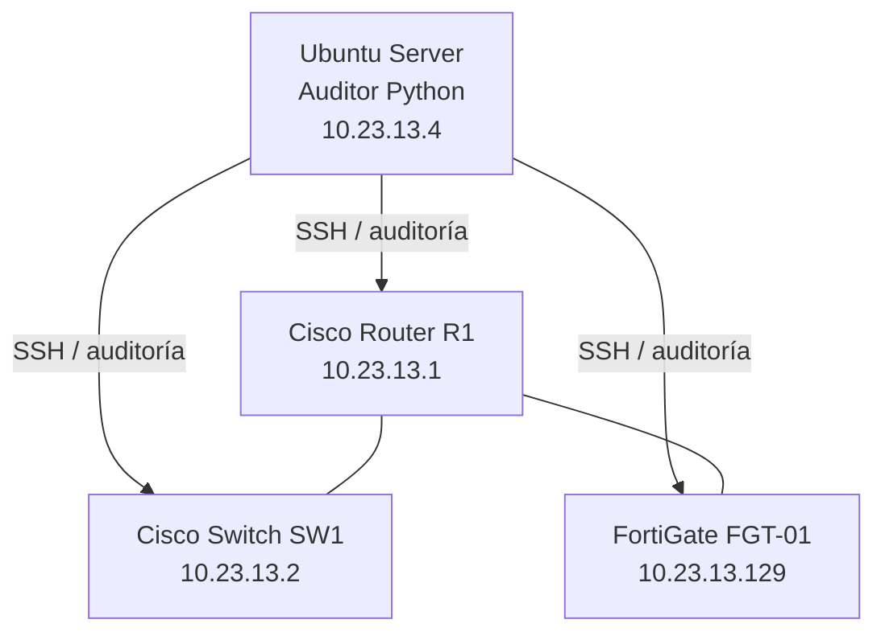

# 2. Topología de red

## Inventario
| Dispositivo | IP | Función |
|---|---|---|
| Ubuntu Server | 10.23.13.4 | Servidor auditor Python |
| R1 | 10.23.13.1 | Router |
| SW1 | 10.23.13.2 | Switch |
| FGT-01 | 10.23.13.129 | Firewall |

## Diagrama lógico

Adjunta una captura real de GNS3 en `docs/images/topologia.png`.
